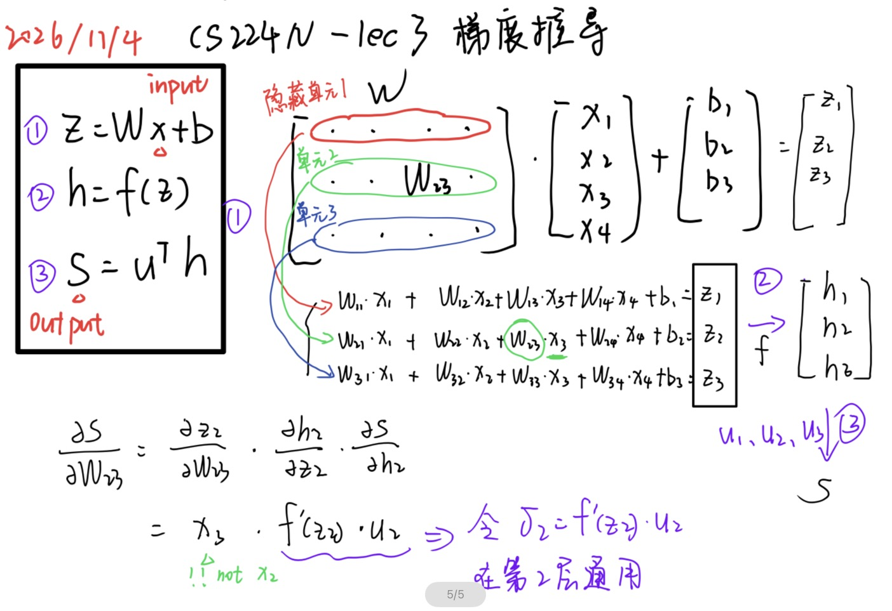

****
# Intro

**隐藏层与概率**
m表示隐藏单元个数

| 运算                | 输出形状 | 这一步在做什么                        |
| ----------------- | ---- | ------------------------------ |
| z=Wx+b            | m×1  | W的每一行和 x 做一次点积，再加上对应的偏置        |
| h=f(z)            | m×1  | 激活函数（activation function）逐元素作用 |
| s=u^T* h          | 标量   | 对 m个隐藏层输出加权求和，得到地点类别的分数        |
| σ(s)=1/(1+e^(-3)) | 标量   | 用 sigmoid 把分数映射成中心词为地点的预测概率    |

**non linearities非线性的重要性**
如果隐藏层之间只有矩阵乘法和偏置，相当于只有一个仿射变换affine transformation

**参数更新**
$$
 \theta^{\mathrm{new}} = \theta^{\mathrm{old}} - \alpha\nabla_\theta J(\theta^{\mathrm{old}}). 
$$

# 矩阵微积分：梯度、雅可比矩阵与链式法则
**梯度gradient**
偏导数partial derivative：某个输入的微小变化怎么影响输出？

**Jacob矩阵**

$$
 y_1=2x_1+x_2,\qquad y_2=x_1-x_2,\qquad L=3y_1+4y_2
$$
$$
 J_{y,x} = \begin{bmatrix} 2 & 1\\ 1 & -1 \end{bmatrix}. 
$$
只有对角线上的偏导数可能非0

**chain rule链式法则**

$$
 \frac{\partial L}{\partial x_1} = \frac{\partial L}{\partial y_1}\frac{\partial y_1}{\partial x_1} + \frac{\partial L}{\partial y_2}\frac{\partial y_2}{\partial x_1} = 3\cdot2+4\cdot1=10. 
$$
$$
 \underbrace{\begin{bmatrix}3&4\end{bmatrix}}_{L\text{ 对 }y_1,y_2\text{ 的变化率}} \underbrace{\begin{bmatrix}2&1\\1&-1\end{bmatrix}}_{y_1,y_2\text{ 对 }x_1,x_2\text{ 的变化率}} = \begin{bmatrix}10&-1\end{bmatrix}. 
$$

# 梯度计算
一个隐藏层由多个隐藏单元组成。
两种权重：进入神经元的权重W和从神经元通往分数s的权重u

**推导**：若改变W_23，如何影响输出s?

**上游梯度upstream gradient/error signal**
$$
 \delta_2=\frac{\partial s}{\partial z_2}=u_2f'(z_2). 
$$
含义：在当前样本上，稍微改变z2，分数s会以怎样的速率变化？

1. 对某个权重W_ij：
$$
\partial s/\partial W_{ij}=\delta_i x_j
$$
第i个隐藏单元，第j个输入。

2. 对某个偏置b_i:
$$
\frac{\partial s}{\partial b_i}=\delta_i
$$

如果要从分数损失直接到梯度损失:
$$
 \frac{\partial J}{\partial W_{ij}} = \frac{\partial J}{\partial s}\,\delta_i x_j. 
$$

# 计算图与反向传播(computation graph and backpropagation)
$$
 \frac{\partial F}{\partial a} = \underbrace{\frac{\partial F}{\partial p}}_{\text{上游梯度 }=2} \cdot \underbrace{\frac{\partial p}{\partial a}}_{\text{局部导数 }=1} =2. 
$$
上游梯度upstream gradient：当前运算的输出p怎样影响最终结果（中间量）
局部函数local derivative：当前一小步的参数a怎么影响p

**同个参数涉及不同分支**
$$
 \frac{\partial F}{\partial x} = \underbrace{\frac{\partial F}{\partial p}\frac{\partial p}{\partial x}}_{\text{经过 }p\text{ 的贡献 }=2\times1} + \underbrace{\frac{\partial F}{\partial q}\frac{\partial q}{\partial x}}_{\text{经过 }q\text{ 的贡献 }=3\times1} =5. 
$$
一条路径相乘，不同路径相加。

# 自动微分与梯度检查
**自动微分automatic differentiation**
利用每个运算的局部求导规则，通过链式法则计算整个计算图的导数。

前向传播计算各步的输出，并保留反向计算需要的中间值。反向传播从损失出发，按相反顺序传递梯度。

| 接口         | 负责什么              | 以乘法 \(v=pq\) 为例               |
| ---------- | ----------------- | ----------------------------- |
| `forward`  | 计算输出，并保留反向所需的值    | 算出 \(v\)，保留 \(p,q\)           |
| `backward` | 接收上游梯度，算出传给各输入的梯度 | 若收到 g=ΔL/Δv ，就给 p 传gq，给 q传 gp |

downstream gradient=upstream gradient × local gradient

**梯度检查gradient checking**
中心差分central difference: 固定数据和其他参数，把要研究的参数微调(再做两次前向计算)，观察损失实际如何变化
$$
 \frac{\partial L}{\partial w} \approx \frac{L(w+\varepsilon)-L(w-\varepsilon)}{2\varepsilon}. 
$$
[复习：PyTorch 自动求导](../../01-pytorchbasics/A-NOTE.md#pytorch自动求导)
